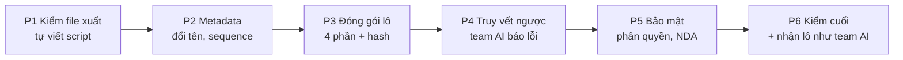

# Day 10 Lab — Bàn giao dữ liệu & Truy vết (cá nhân)

**Làm cá nhân · ~4,5 giờ · 40 ảnh đường phố · CVAT + Python (chỉ thư viện chuẩn)**

Ở Day 7–9 bạn đã gán nhãn, kiểm QC và tự động hoá kiểm tra. Hôm nay là **mắt xích cuối**: một lô nhãn đến tay team AI
phải **dùng được ngay mà không ai phải hỏi lại bạn**, và khi team AI báo lỗi, bạn **khoanh vùng được ảnh cần sửa trong vài phút**.

Bạn sẽ đi hết một vòng bàn giao thật:

| Pha | Bạn làm | Sản phẩm chính |
|---|---|---|
| P1 | Kiểm file xuất bằng **script do bạn viết**, đối soát với CVAT, báo lỗi | `kiem_lo.py`, báo cáo kiểm, `bug_ticket.md` |
| P2 | Chuẩn hoá metadata, đổi tên ảnh, xử lý sequence trùng mã | `rename_map.csv`, `seq_remap.csv` |
| P3 | Đóng gói lô đủ bốn phần, ghi hash, lập phiếu bàn giao | thư mục `lo_NNN_v1/`, `phieu_ban_giao.md` |
| P4 | Lập bảng truy vết, chia train/val không rò rỉ, xử lý báo lỗi của team AI | `truyvet.csv`, `impact_analysis.md` |
| P5 | Phân tích tình huống bảo mật | `security.md` |
| P6 | Chạy bộ kiểm cuối, nhận lô như team AI, tự đánh giá | `individual_note.md` |

## Bạn chọn dữ liệu

| | **Track A — lô của bạn** | **Track B — starter pack** |
|---|---|---|
| Dành cho | Đã có nhãn riêng từ Day 7 / Day 9 xuất bằng CVAT (≥ 40 ảnh) | Chưa có nhãn, hoặc muốn làm nhanh |
| Nguồn | Ảnh/nhãn Day 7–9 của bạn (hoặc bộ khác **công khai, giấy phép mở**) | `data/starter/` (40 ảnh Day 7 + giấy tờ giả định + file xuất có lỗi cài sẵn) |
| Lợi thế | Số liệu thật, truy vết thật | Lỗi cài sẵn đủ loại, mọi nguồn truy vết đã có |
| Lưu ý | Phải tự có người gán/người kiểm/guideline ≥ 2 phiên bản (xem [data/README.md](data/README.md)) | Nhãn là nhãn **luyện tập tổng hợp**, không phản ánh nội dung ảnh |

Hai track dùng chung quy trình, bộ kiểm và rubric.

## Bắt đầu

1. `git clone` repo, `cd` vào thư mục. Cần **Python 3.9+** (macOS/Linux: `python3 --version`; Windows: `py --version`). Không cần `pip install` gì. GUIDE.md có bảng "cách gõ lệnh" cho Windows/macOS.
2. Đọc **[GUIDE.md](GUIDE.md)** (từng pha, lệnh chạy) và **[RULES.md](RULES.md)**.
3. Sửa [lab_config.json](lab_config.json) (Pha 0), rồi làm theo thứ tự P1 → P6.
4. Trước khi nộp: `python scripts/check_batch.py` không còn `FAIL`.

> **Khi nộp:** đổi dòng tiêu đề này thành `# Day 10 Lab — <MSHV> - <Họ và tên>`. Xem [SUBMISSION.md](SUBMISSION.md).

## Tài liệu

| Bạn cần | Xem |
|---|---|
| Các pha và lệnh | [GUIDE.md](GUIDE.md) |
| Mốc tiến độ 4,5 giờ | [CHECKPOINTS.md](CHECKPOINTS.md) |
| Quy tắc làm bài, dùng AI | [RULES.md](RULES.md) |
| Chấm điểm (100 điểm) | [RUBRIC.md](RUBRIC.md) |
| Sản phẩm nộp, cấu trúc thư mục | [SUBMISSION.md](SUBMISSION.md) |
| Tóm tắt kiến thức (cấu trúc lô, 4 câu kiểm, metadata, ngưỡng) | [docs/HANDOVER_CHEATSHEET.md](docs/HANDOVER_CHEATSHEET.md) |
| Xuất / nhập nhãn ở CVAT, lấy số nhãn | [docs/CVAT_EXPORT.md](docs/CVAT_EXPORT.md) |
| Dữ liệu hai track | [data/README.md](data/README.md), [data/starter/README.md](data/starter/README.md) |
| Các script | [scripts/README.md](scripts/README.md) |
| Mẫu file phải điền | [docs/templates/](docs/templates/) |
