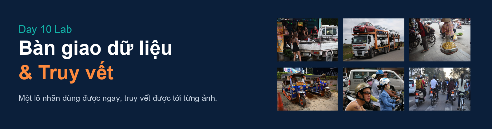
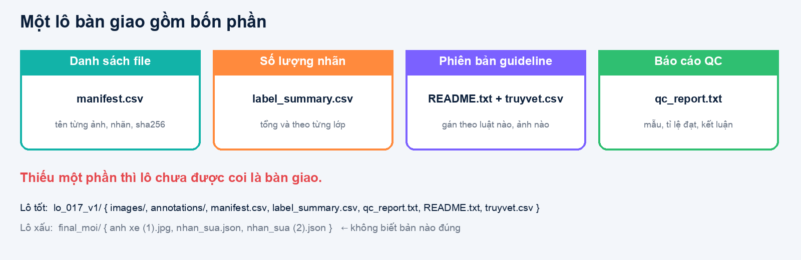
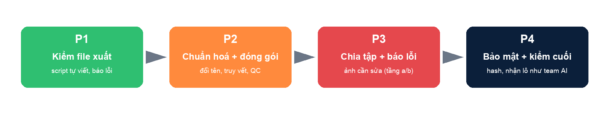
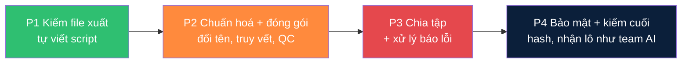
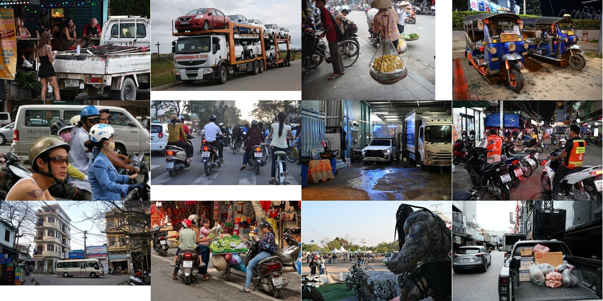

  

# Day 10 Lab — Bàn giao dữ liệu & Truy vết

  
  
  
  
  

> **Lô đến tay team AI phải dùng được ngay mà không ai phải hỏi lại bạn.** Khi họ báo lỗi, bạn khoanh vùng được ảnh cần sửa trong vài phút, nhờ truy vết.

## Bạn sẽ làm gì

Ở Day 7–9 bạn đã gán nhãn, kiểm QC và tự động hoá kiểm tra. Hôm nay là **mắt xích cuối**: kiểm file xuất, chuẩn hoá metadata, đóng gói đủ bốn phần, ghi hash, lập bảng truy vết, rồi xử lý một báo lỗi từ team AI.

| Việc | Công cụ |
|---|---|
| Kiểm file xuất (mở lại được · đúng tên lớp · đủ số nhãn · đúng định dạng) | **script `kiem_lo.py` do bạn tự viết**, CVAT Info |
| Chuẩn hoá metadata, đổi tên ảnh, sequence ID | `check_names.py`, `apply_rename.py` |
| Đóng gói lô + hash | `build_manifest.py`, `build_label_summary.py`, `pack_batch.py`, `hash_file.py` |
| Truy vết, chia tập không rò rỉ, khoanh vùng lỗi | `truyvet.csv`, `make_split.py`, `trace_query.py` |
| Bảo mật: ca USB, ca khuôn mặt, tự soi dữ liệu | `security.md` |
| Kiểm cuối và nhận lô như team AI | `check_submission.py`, `receive_batch.py` |

## Lộ trình

## Bạn chọn dữ liệu

| | **Track A — lô của bạn** | **Track B — starter pack** |
|---|---|---|
| Dành cho | Đã có nhãn riêng từ Day 7 / Day 9 xuất bằng CVAT (≥ 40 ảnh) | Chưa có nhãn, hoặc muốn làm nhanh |
| Nguồn | Ảnh/nhãn Day 7–9 của bạn (hoặc bộ khác **công khai, giấy phép mở**) | `data/starter/`: 40 ảnh Day 7 (CC BY / CC BY-SA / CC0) + giấy tờ giả định + file xuất có lỗi cài sẵn |
| Lợi thế | Số liệu thật, truy vết thật | Lỗi cài sẵn đủ loại, mọi nguồn truy vết đã có |
| Lưu ý | Phải có người gán/người kiểm/guideline ≥ 2 phiên bản ([data/README.md](data/README.md)) | Nhãn là nhãn **luyện tập tổng hợp**, không phản ánh nội dung ảnh |

Hai track dùng chung quy trình, bộ kiểm và rubric.

## Bắt đầu nhanh (5 bước)

1. **Fork** repo thành repo **public** của bạn (tên: xem [SUBMISSION.md](SUBMISSION.md)), `git clone`.
2. Kiểm Python: macOS/Linux `python3 --version`, Windows `py --version` (cần 3.9+). **Không cần `pip install`.** [GUIDE.md](GUIDE.md) có bảng cách gõ lệnh cho từng hệ điều hành.
3. Điền [lab_config.json](lab_config.json) (Pha 0) và chọn Track A/B. Bài có **5 pha, 13 bước**.
4. Làm theo **[GUIDE.md](GUIDE.md)** từ **P1**. Track B: chưa mở `cvat_export_2_reexport/` cho tới khi nộp báo lỗi.
5. Chạy `python scripts/check_submission.py` trước khi nộp.

> **Khi nộp:** đổi dòng tiêu đề này thành `# Day 10 Lab — <MSHV> - <Họ và tên>`. Xem [SUBMISSION.md](SUBMISSION.md).

<b>Vì sao phải tự viết <code>kiem_lo.py</code> và làm mutation test?</b>

Script im lặng không có nghĩa là file sạch: có thể script mù. Bạn cài lỗi có chủ đích vào một file giả nhỏ, rồi chứng minh script bắt được từng lỗi. Bộ kiểm cuối còn **chạy lại script của bạn** trên export lần 1 (phải KHÔNG ĐẠT) và lần 2 (phải ĐẠT).

<b>PASS của bộ kiểm có nghĩa là nhãn đúng không?</b>

Không. PASS = đúng **định dạng và nhất quán** (mở được, tên lớp, số lượng, hash, metadata). Nhãn đúng hay sai vẫn là việc QC của người. Một câu trong `individual_note.md` hỏi đúng điều này.

<b>Mình dùng Windows / Mac thì sao?</b>

- **Windows (PowerShell):** gọi `py`, chạy từng lệnh riêng (không `&&`), đừng dùng `>` để ghi báo cáo (script có `--out`), thêm `-X utf8` nếu lỗi font.
- **macOS:** dùng `python3`; file ẩn như `.DS_Store` được tự bỏ qua; soạn `README.txt` ở dạng văn bản thuần (TextEdit → *Make Plain Text*).
- **Không có CVAT:** Track B làm đủ P1–P4 không cần CVAT.

## Tài liệu

| Bạn cần | Xem |
|---|---|
| Các pha và lệnh chạy | [GUIDE.md](GUIDE.md) |
| Mốc tiến độ 3 giờ | [CHECKPOINTS.md](CHECKPOINTS.md) |
| Quy tắc làm bài, dùng AI | [RULES.md](RULES.md) |
| Chấm điểm (100 điểm) | [RUBRIC.md](RUBRIC.md) |
| Sản phẩm phải nộp, tên repo | [SUBMISSION.md](SUBMISSION.md) |
| Tóm tắt kiến thức (cấu trúc lô, 4 câu kiểm, metadata, ngưỡng) | [docs/HANDOVER_CHEATSHEET.md](docs/HANDOVER_CHEATSHEET.md) |
| CVAT: xuất, nhập lại, lấy số nhãn | [docs/CVAT_EXPORT.md](docs/CVAT_EXPORT.md) |
| Dữ liệu hai track | [data/README.md](data/README.md), [data/starter/README.md](data/starter/README.md) |
| Các script, mã kiểm A–G | [scripts/README.md](scripts/README.md) |
| Mẫu file phải điền | [docs/templates/](docs/templates/) |
| Thông tin & kết quả tóm tắt của bạn | [STUDENT.md](STUDENT.md) |
| Review lab bằng học viên giả lập | [_review/](_review/) |

## Bạn học được gì

- Đóng gói lô **đủ bốn phần**, đặt tên theo quy ước, mỗi phiên bản một tên mới (không ghi đè).
- Kiểm file xuất bằng **bốn câu kiểm** và biết giới hạn của script (PASS ≠ nhãn đúng).
- Dùng **hash** chứng minh file không đổi; dùng **metadata** (xe, ngày, camera, sequence) để chia tập không rò rỉ.
- **Truy vết** ai gán, ai kiểm, guideline nào để khoanh vùng lỗi nhỏ nhất.
- Làm việc an toàn: phân quyền, dữ liệu ở lại hệ thống, NDA, dùng AI chỉ với dữ liệu giả.

Hình minh hoạ do giảng viên vẽ (`docs/assets/make_figures.py`). Ảnh dữ liệu: xem `data/starter/ATTRIBUTION.csv`.
